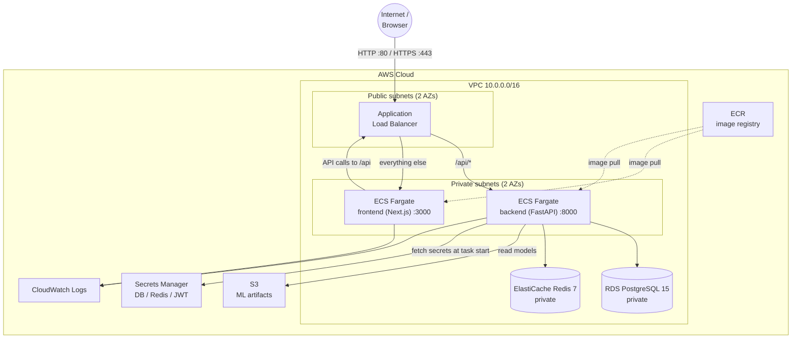
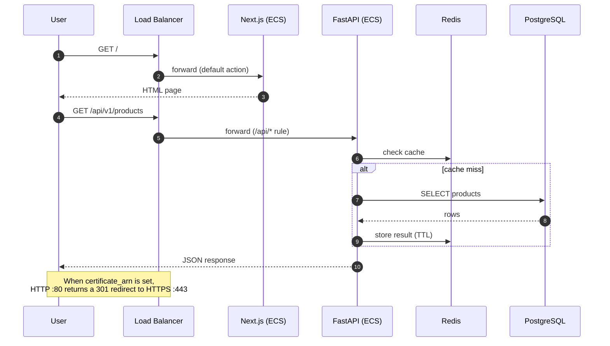
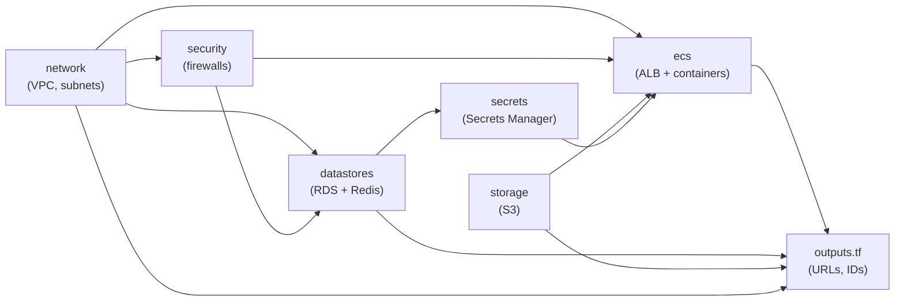
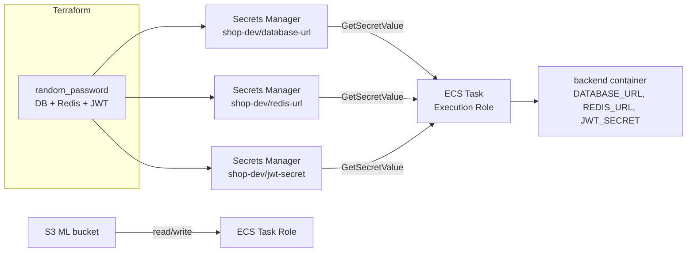

# Shop E-Commerce — Terraform Infrastructure

Infrastructure-as-Code for the **shop e-commerce recommender** application. This
directory provisions a production-shaped AWS environment (VPC, ECS Fargate,
RDS PostgreSQL, ElastiCache Redis, S3, Secrets Manager, ECR, ALB, CloudWatch) and
wires the frontend (Next.js) and backend (FastAPI) services together.

> New to Terraform? Start with [Terraform in 60 seconds](#terraform-in-60-seconds),
> then follow [Quick start](#quick-start).

---

## Table of contents

1. [What this provisions](#what-this-provisions)
2. [Terraform in 60 seconds](#terraform-in-60-seconds)
3. [Architecture](#architecture)
4. [Request flow](#request-flow)
5. [Module dependency graph](#module-dependency-graph)
6. [Directory structure](#directory-structure)
7. [Resource inventory](#resource-inventory)
8. [Prerequisites](#prerequisites)
9. [Quick start](#quick-start)
10. [Build and push container images](#build-and-push-container-images)
11. [Variables reference](#variables-reference)
12. [Outputs reference](#outputs-reference)
13. [Secrets and security model](#secrets-and-security-model)
14. [Remote state for teams](#remote-state-for-teams)
15. [Scaling](#scaling)
16. [Cost notes](#cost-notes)
17. [Command cheat sheet](#command-cheat-sheet)
18. [Troubleshooting](#troubleshooting)
19. [Tear down](#tear-down)

---

## What this provisions

| Layer | AWS service | Purpose |
|-------|-------------|---------|
| Network | VPC, subnets, IGW, NAT, route tables | Isolated network with public + private tiers across 2 AZs |
| Load balancing | Application Load Balancer | Single public entry point, path-based routing |
| Compute | ECS Fargate | Runs frontend and backend containers serverless (no EC2 to manage) |
| Database | RDS PostgreSQL 15 | Persistent application data |
| Cache | ElastiCache Redis 7 | Recommendation cache |
| Object storage | S3 | ML model artifacts |
| Secrets | Secrets Manager | DB URL, Redis URL, JWT secret injected into the backend |
| Registry | ECR | Stores the frontend/backend Docker images |
| Logging | CloudWatch Logs | Container logs with retention |
| Autoscaling | Application Auto Scaling | Scales ECS tasks on CPU utilization |

---

## Terraform in 60 seconds

Terraform is a tool that lets you describe cloud infrastructure in text files and
then creates it for you, repeatably.

- **Providers** — plugins that talk to APIs (here: `aws`, `random`). Declared in
  `main.tf` under `required_providers` and downloaded by `terraform init`.
- **Resources** — a single thing to create (`aws_vpc`, `aws_db_instance`, …).
- **Modules** — a reusable folder of resources. This project has five under
  `modules/`. The root files wire them together.
- **State** — Terraform records what it created in `terraform.tfstate`. It is the
  source of truth for future changes. **Never edit or commit it.**
- **Plan vs apply** — `terraform plan` shows what *would* change;
  `terraform apply` actually makes the change.

The four core commands you will use:

```bash
terraform init      # download providers and modules (run once)
terraform validate  # check the configuration is syntactically correct
terraform plan      # preview changes
terraform apply     # create/update infrastructure
```

---

## Architecture

Everything runs inside one VPC. Only the load balancer is publicly reachable;
the application containers, database and cache live in private subnets.



- **Public subnets** host only the ALB and NAT gateway.
- **Private subnets** host the ECS tasks, RDS and Redis. They have no public IP.
- **NAT gateway** lets private resources make *outbound* calls (e.g. pulling
  images, calling external APIs) without being reachable from the internet.

---

## Request flow



**Why `/api` routing works without a reverse-proxy container:** the backend is
started with `--root-path /api` and exposes its routers under `/api/v1/...`, so
the ALB can forward `/api/*` straight to the backend while everything else goes
to the frontend.

---

## Module dependency graph

Terraform works out the order automatically from these references:



---

## Directory structure

```
tf-demo/
├── main.tf                    # provider config, locals, module wiring
├── variables.tf               # all input variables + defaults
├── outputs.tf                 # values printed after apply
├── secrets.tf                 # Secrets Manager resources (DB/Redis/JWT)
├── terraform.tfvars.example   # copy to terraform.tfvars and edit
├── README.md                  # this file
└── modules/
    ├── network/               # VPC, subnets, IGW, NAT, routes
    │   ├── main.tf
    │   ├── variables.tf
    │   └── outputs.tf
    ├── security/              # ALB / app / DB / cache security groups
    ├── datastores/            # RDS PostgreSQL + ElastiCache Redis
    ├── storage/               # S3 bucket for ML artifacts
    └── ecs/                   # ECR, ECS, IAM, ALB, services, autoscaling
        ├── ecr.tf             # container image repositories
        ├── cluster.tf         # ECS cluster + CloudWatch log groups
        ├── iam.tf             # task execution & task roles
        ├── task_definitions.tf# frontend + backend container definitions
        ├── alb.tf             # load balancer, target groups, listeners/rules
        ├── services.tf        # ECS services
        ├── autoscaling.tf     # CPU-based scaling policies
        ├── locals.tf          # derived image URIs / flags
        ├── variables.tf
        └── outputs.tf
```

A **module** is just a folder with `main.tf` (resources), `variables.tf`
(inputs) and `outputs.tf` (values exposed to the caller).

---

## Resource inventory

| Module | Key resources |
|--------|---------------|
| `network` | `aws_vpc`, `aws_subnet` (public/private), `aws_internet_gateway`, `aws_eip`, `aws_nat_gateway`, `aws_route_table`, `aws_route`, `aws_route_table_association` |
| `security` | `aws_security_group` ×4 (alb, app, db, cache) with least-privilege ingress |
| `datastores` | `aws_db_subnet_group`, `aws_db_instance`, `random_password`, `aws_elasticache_subnet_group`, `aws_elasticache_replication_group` |
| `storage` | `aws_s3_bucket`, versioning, SSE, public-access block, lifecycle policy |
| `ecs` | `aws_ecr_repository` ×2 + lifecycle, `aws_ecs_cluster`, `aws_cloudwatch_log_group` ×2, IAM roles/policies, `aws_ecs_task_definition` ×2, `aws_lb` + target groups + listeners + rules, `aws_ecs_service` ×2, `aws_appautoscaling_target`/`policy` ×2 |
| root (`secrets.tf`) | `aws_secretsmanager_secret` + `_secret_version` ×3 (database-url, redis-url, jwt-secret) |

---

## Prerequisites

1. **Terraform** (`>= 1.5.0`). On this machine it is installed at
   `~/.local/bin/terraform`. Verify:

   ```bash
   terraform -v
   ```

   If not found, install the Linux amd64 build:

   ```bash
   curl -fsSL -o /tmp/tf.zip https://releases.hashicorp.com/terraform/1.9.8/terraform_1.9.8_linux_amd64.zip
   python3 -c "import zipfile; zipfile.ZipFile('/tmp/tf.zip').extractall('/tmp')"
   install -m 0755 /tmp/terraform ~/.local/bin/terraform
   ```

2. **AWS credentials** with permission to create the resources above. Configure
   with the AWS CLI:

   ```bash
   aws configure            # or: export AWS_PROFILE=my-profile
   aws sts get-caller-identity   # sanity check
   ```

3. **Docker** (only needed to build/push images).

4. Region/account context — this config uses `aws_region` and the caller's
   account ID automatically (`data.aws_caller_identity`).

---

## Quick start

```bash
cd tf-demo

# 1. (optional) create your own variable file
cp terraform.tfvars.example terraform.tfvars
# edit terraform.tfvars as needed (region, sizes, URLs, ...)

# 2. download providers
terraform init

# 3. check for syntax/type errors
terraform validate

# 4. preview exactly what will be created
terraform plan

# 5. create the infrastructure (takes ~15-20 min: RDS + Redis are slow)
terraform apply
```

When `apply` finishes, Terraform prints the outputs. The most useful ones:

```bash
terraform output application_url        # where the app will be reachable
terraform output ecr_repository_urls    # where to push your images
terraform output -raw database_address  # (sensitive) RDS hostname
```

> The first `apply` creates empty ECR repositories. The ECS services will be
> healthy only after you push images (next section).

---

## Build and push container images

The ECS module creates two ECR repositories. Push the app images to them.

```bash
REGION=$(terraform output -raw aws_region)
ACCOUNT=$(aws sts get-caller-identity --query Account --output text)
REGISTRY="$ACCOUNT.dkr.ecr.$REGION.amazonaws.com"

# authenticate Docker to ECR
aws ecr get-login-password --region "$REGION" \
  | docker login --username AWS --password-stdin "$REGISTRY"

# ---- backend (FastAPI) ----
docker build -t "$REGISTRY/shop-dev/backend:latest" ../backend
docker push "$REGISTRY/shop-dev/backend:latest"

# ---- frontend (Next.js) ----
docker build \
  --build-arg NEXT_PUBLIC_API_URL=/api \
  -t "$REGISTRY/shop-dev/frontend:latest" ../frontend
docker push "$REGISTRY/shop-dev/frontend:latest"
```

Then roll the services so they pull the new images:

```bash
aws ecs update-service --cluster shop-dev --service shop-dev-backend  --force-new-deployment
aws ecs update-service --cluster shop-dev --service shop-dev-frontend --force-new-deployment
```

Repository names use the `name` prefix (`shop-dev` = `project_name`-`environment`).
To use images from a different registry, set `frontend_image` / `backend_image`
to full repository URLs in `terraform.tfvars`.

---

## Variables reference

All variables live in `variables.tf`. Override them in `terraform.tfvars` or with
`-var 'name=value'`.

### Core

| Variable | Type | Default | Description |
|----------|------|---------|-------------|
| `aws_region` | string | `us-east-1` | AWS region |
| `project_name` | string | `shop` | Prefix for resource names/tags |
| `environment` | string | `dev` | Environment (`dev`/`staging`/`prod`) |

### Networking

| Variable | Default | Description |
|----------|---------|-------------|
| `vpc_cidr` | `10.0.0.0/16` | VPC address range |
| `availability_zone_count` | `2` | Number of AZs to spread across |
| `public_subnet_cidrs` | `["10.0.1.0/24","10.0.2.0/24"]` | Public subnet ranges |
| `private_subnet_cidrs` | `["10.0.11.0/24","10.0.12.0/24"]` | Private subnet ranges |
| `enable_nat_gateway` | `true` | Allow private subnets outbound internet |
| `single_nat_gateway` | `true` | One shared NAT (cheaper) vs one per AZ (HA) |
| `alb_ingress_cidrs` | `["0.0.0.0/0"]` | Who may reach the load balancer |

### Database (RDS PostgreSQL)

| Variable | Default | Description |
|----------|---------|-------------|
| `db_name` | `recommender_db` | Database name |
| `db_username` | `recommender_user` | Master username |
| `db_engine_version` | `15` | PostgreSQL version |
| `db_instance_class` | `db.t4g.micro` | Instance size |
| `db_allocated_storage` | `20` | Storage in GiB |
| `db_multi_az` | `false` | Multi-AZ failover (use `true` in prod) |
| `db_backup_retention_days` | `7` | Backup retention |
| `db_deletion_protection` | `false` | Block accidental deletion |

### Cache (ElastiCache Redis)

| Variable | Default | Description |
|----------|---------|-------------|
| `cache_node_type` | `cache.t4g.micro` | Node size |
| `cache_num_nodes` | `1` | Number of nodes |
| `cache_engine_version` | `7.1` | Redis version |

### Containers / ECS

| Variable | Default | Description |
|----------|---------|-------------|
| `frontend_image` | `""` | Full image URL (empty ⇒ use created ECR repo) |
| `frontend_image_tag` | `latest` | Image tag |
| `backend_image` | `""` | Full image URL (empty ⇒ use created ECR repo) |
| `backend_image_tag` | `latest` | Image tag |
| `frontend_container_port` | `3000` | Frontend port |
| `backend_container_port` | `8000` | Backend port |
| `frontend_desired_count` | `2` | Starting task count |
| `backend_desired_count` | `2` | Starting task count |
| `frontend_cpu` | `256` | CPU units (1024 = 1 vCPU) |
| `frontend_memory` | `512` | Memory MiB |
| `backend_cpu` | `512` | CPU units |
| `backend_memory` | `1024` | Memory MiB |
| `frontend_api_url` | `/api` | `NEXT_PUBLIC_API_URL` baked into the frontend |
| `enable_autoscaling` | `true` | Enable CPU-based scaling |
| `autoscaling_max_count` | `6` | Max tasks per service |

### App / TLS / observability

| Variable | Default | Description |
|----------|---------|-------------|
| `frontend_url` | `http://localhost` | Public URL for CORS/redirects |
| `cors_origins` | `http://localhost` | Comma-separated allowed origins |
| `certificate_arn` | `""` | ACM cert ARN ⇒ enables HTTPS + HTTP redirect |
| `log_retention_days` | `30` | CloudWatch retention |
| `secret_recovery_window_in_days` | `0` | Secrets recovery window (`0` = delete now) |
| `s3_force_destroy` | `false` | Allow deleting the S3 bucket with contents |

---

## Outputs reference

After `terraform apply`:

| Output | Description |
|--------|-------------|
| `aws_region` | Configured region |
| `name_prefix` | Generated prefix (`shop-dev`) |
| `vpc_id` | VPC ID |
| `public_subnet_ids` | Public subnet IDs |
| `private_subnet_ids` | Private subnet IDs |
| `load_balancer_dns_name` | ALB DNS name |
| `application_url` | `http(s)://<alb-dns>` |
| `ecr_repository_urls` | Map of `frontend` / `backend` ECR URLs |
| `database_address` | RDS hostname (**sensitive**) |
| `redis_address` | Redis primary endpoint (**sensitive**) |
| `ml_artifacts_bucket` | S3 bucket name |
| `ecs_cluster_name` | ECS cluster name |
| `backend_log_group` / `frontend_log_group` | CloudWatch log group names |

Read sensitive values with `terraform output -raw <name>`.

---

## Secrets and security model



- **No secrets in code or state inputs.** Passwords are generated by
  `random_password` and stored in AWS Secrets Manager.
- **Two IAM roles per task:**
  - *Execution role* — pulls images, writes logs, reads the three secrets.
  - *Task role* — the app's own permissions (read/write ML artifacts bucket).
- **Security groups** implement least privilege:
  - ALB accepts `80`/`443` from `alb_ingress_cidrs`.
  - App tasks accept `3000`/`8000` **only from the ALB security group**.
  - RDS accepts `5432` **only from the app security group**.
  - Redis accepts `6379` **only from the app security group**.
- **Encryption:** RDS and Redis at rest + Redis in transit; S3 SSE + versioned;
  secrets encrypted by Secrets Manager.
- `.gitignore` excludes `*.tfstate*`, `.terraform/` and real `*.tfvars` so state
  and secrets never get committed.

### Optional: enable HTTPS

1. Request/import an ACM certificate (must be in the same region as the ALB).
2. Set `certificate_arn = "arn:aws:acm:..."` in `terraform.tfvars`.
3. `terraform apply`.

This adds a `443` listener and makes `80` redirect to it.

---

## Remote state for teams

By default state is stored locally in `terraform.tfstate`, which is fine for one
person but unsafe for teams. Configure the S3 backend (commented in `main.tf`):

```bash
# one-time bootstrap (outside Terraform, or a separate bootstrap config)
aws s3api create-bucket --bucket my-terraform-state --region us-east-1
aws s3api put-bucket-versioning --bucket my-terraform-state \
  --versioning-configuration Status=Enabled
aws dynamodb create-table --table-name terraform-locks \
  --attribute-definitions AttributeName=LockID,AttributeType=S \
  --key-schema AttributeName=LockID,KeyType=HASH \
  --billing-mode PAY_PER_REQUEST
```

Then uncomment the `backend "s3"` block in `main.tf` and run
`terraform init -migrate-state`.

---

## Scaling

- Each service runs `N` Fargate tasks behind the ALB.
- With `enable_autoscaling = true`, Application Auto Scaling adds/removes tasks
  to keep average CPU near **70%**, between `*_desired_count` (min) and
  `autoscaling_max_count` (max).
- `desired_count` is ignored by Terraform after creation so autoscaling isn't
  fought by subsequent applies.

---

## Cost notes

Approximate `dev` defaults (us-east-1, on-demand) — **verify with the AWS
pricing calculator**; this is a rough guide, not a quote:

| Item | Rough monthly |
|------|----------------|
| 2 × ECS Fargate tasks (frontend) | ~$15–30 |
| 2 × ECS Fargate tasks (backend) | ~$30–60 |
| NAT gateway (single) + data | ~$35 |
| ALB | ~$20 |
| RDS `db.t4g.micro` + 20 GiB | ~$15 |
| ElastiCache `cache.t4g.micro` | ~$13 |
| S3, ECR, CloudWatch, Secrets | a few $ |

The **NAT gateway and ALB are fixed costs** and often the surprise. For a
throwaway demo, reduce/disable them or `terraform destroy` when idle.

---

## Command cheat sheet

```bash
terraform init                     # download providers/modules
terraform fmt -recursive           # format all .tf files
terraform validate                 # syntax + type check
terraform plan                     # preview changes
terraform plan -out=tf.plan        # save a plan
terraform apply tf.plan            # apply a saved plan
terraform apply -var 'environment=staging'
terraform output                   # show all outputs
terraform output -raw application_url
terraform state list               # list managed resources
terraform state show module.ecs.aws_ecs_cluster.this
terraform destroy                  # delete everything
```

---

## Troubleshooting

| Symptom | Likely cause / fix |
|---------|--------------------|
| `command not found: terraform` | Binary not on PATH. See [Prerequisites](#prerequisites). |
| `Error: No valid credential sources found` | Run `aws configure` or set `AWS_PROFILE`. |
| `Error acquiring the state lock` | Another apply is running, or a stale lock. Check DynamoDB lock table / wait. |
| ECS service tasks keep restarting | Images not pushed yet, or wrong `*_image`/tag. Check CloudWatch log group. |
| Backend unhealthy / 502 on `/api` | Backend can't reach DB/Redis. Check secrets + security groups + logs. |
| `InvalidParameterValue: ... already exists` | A resource from a previous run wasn't cleaned up. Adjust names or import. |
| Frontend can't call the API | `NEXT_PUBLIC_API_URL` must be `/api` (set at **build** time for Next.js). |
| RDS/Redis destroy hangs | `deletion_protection` / subnet leftovers. Set `db_deletion_protection=false` first. |
| Socket/network errors during `init` | Corporate proxy/firewall blocking registry.terraform.io. |

Useful log command:

```bash
aws logs tail "$(terraform output -raw backend_log_group)" --follow
```

---

## Tear down

```bash
# If you enabled deletion protection, disable it first:
#   set db_deletion_protection = false && terraform apply

terraform destroy
```

If the S3 bucket has objects and `s3_force_destroy = false`, the destroy will
fail by design — empty the bucket or set `s3_force_destroy = true`.

> **Important:** destroying removes the RDS instance. With
> `db_deletion_protection = false` it is deleted **without a final snapshot**.
> Keep `deletion_protection = true` and `skip_final_snapshot = false` (managed by
> the `db_deletion_protection` variable) for anything real.
